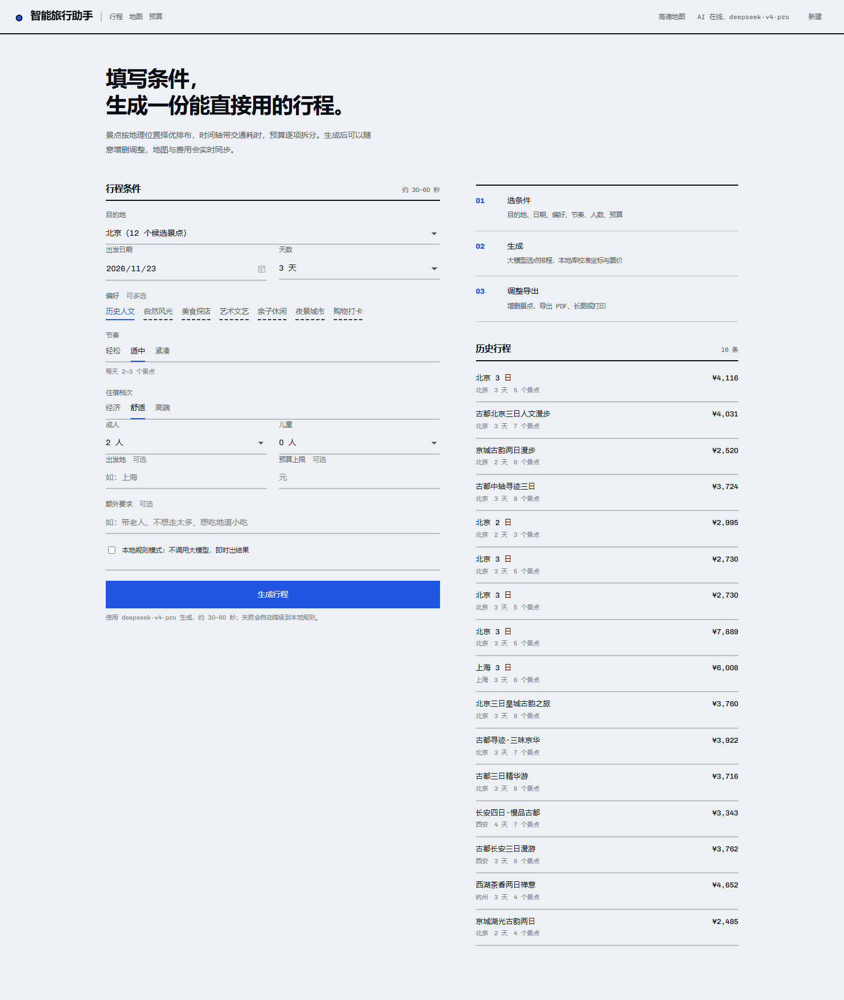
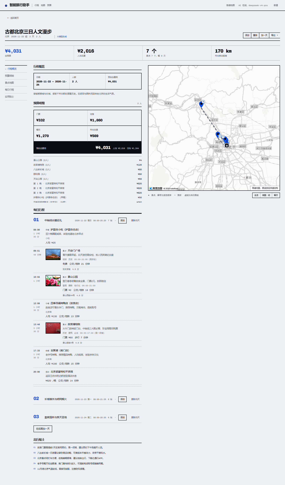
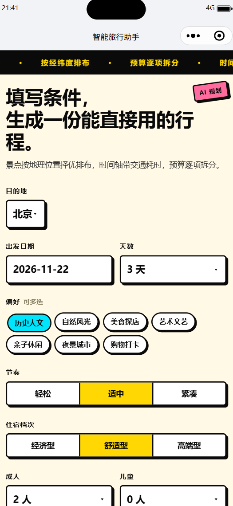
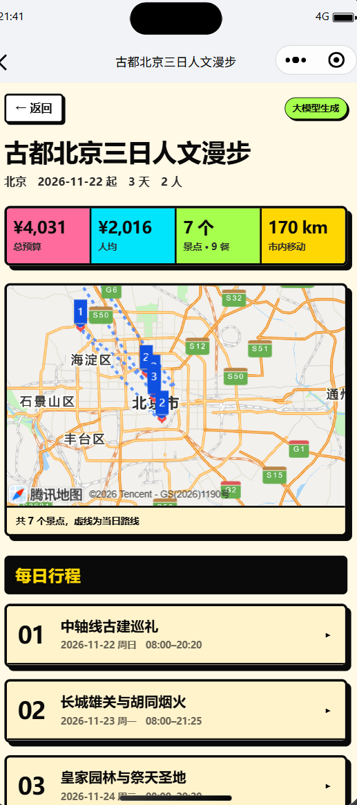

# 智能旅行助手

输入目的地和偏好，生成一份**能直接照着走**的行程：景点按地理位置排布、时间轴带交通耗时、预算逐项拆分、地图实时联动。

不是一个聊天壳子。它解决的是"AI 给了一堆建议，但你还得自己排路线"这件事。



---

## 亮点

**双引擎，永远有结果**
大模型负责选点和叙述，本地规则引擎负责兜底。模型挂了、超时了、没配 Key，规则引擎 0.03 秒出一份能用的行程。

**先秒出，再升级**
点生成，0.05 秒看到完整行程（规则版），AI 版在后台跑完后无缝替换同一条记录。用户不用盯着转圈等 80 秒。

**坐标是真的**
高德 / Leaflet 用的是 GCJ-02，而原始 POI 数据是 WGS-84。混用会让景点偏移 300~500 米——这个坑单独建了 `coords.py` 处理。

**地图两种渲染，自动降级**
高德 JS API 失败自动退回 Leaflet，不会白屏。

**导出不是截图**
PDF 用 reportlab 排版，长图用服务端合成，地图走高德静态图 REST + canvas 叠加编号标注。

---

## 功能

| 模块 | 说明 |
|---|---|
| 行程生成 | 目的地 / 日期 / 偏好 / 节奏 / 住宿档次 / 人数 / 预算 / 额外要求 |
| 地图可视化 | 编号标记、当日虚线路径、逐日配色、餐饮标记开关 |
| 预算拆分 | 门票 / 住宿 / 餐饮 / 市内交通，含逐项明细与超支提示 |
| 实时编辑 | 增删景点、上下移动、锁定、加天删天，地图与费用同步刷新 |
| 导出 | PDF / 长图 / 地图图片 / 打印 |
| 景点实拍 | 高德 POI 图 + 地址 + 评分，点击放大 |
| 小程序版 | 原生小程序，Neo-Brutalism 界面，地图用原生 `<map>` 组件 |



### 小程序版

同一套后端，微信小程序原生重写。界面换成 Neo-Brutalism——奶油底、粗黑边框、硬投影，和 Web 版的编辑风刻意做出区分。

<p>
  
  
</p>

小程序里有两个 Web 端没有的设计决策：

- **地图直接用原生 `<map>`**：坐标本来就存了 GCJ-02，和腾讯地图同一套，不用转
- **`先秒出 + 后台升级`**：小程序里等 80 秒转圈体验极差，所以点生成先返回规则版（0.03s），AI 版回来再覆盖同一条记录

---

## 技术架构

```
┌─────────────────────────────────────────────────────────────┐
│  前端               index.html + app.js（无构建步骤）         │
│  地图               AMap JS API 2.0  ──失败──>  Leaflet      │
└───────────────────────────┬─────────────────────────────────┘
                            │ JSON
┌───────────────────────────▼─────────────────────────────────┐
│  Flask                                                       │
│  ├─ planner.py    双引擎：LLM 排程 + 规则排程                 │
│  ├─ poi_data.py   6 城 POI 库（52 景点 / 36 餐厅 / 酒店）     │
│  ├─ poi_photos.py 高德 POI 图查询（磁盘缓存 30 天）           │
│  ├─ coords.py     WGS-84 ↔ GCJ-02                            │
│  └─ exporter.py   reportlab PDF + 打印 HTML                  │
└───────────────────────────┬─────────────────────────────────┘
                            │
        ┌───────────────────┼───────────────────┐
        ▼                   ▼                   ▼
   DeepSeek API        高德 REST API        本地 trips.json
   (JSON 模式)      (POI / 静态图 / 图片)
```

### 为什么有规则引擎

大模型有三个问题：慢（80 秒）、贵、会幻觉。规则引擎不是"降级方案"，是**主路径的一部分**：

- 用户点生成 → 立刻返回规则版（0.03s）
- 同时后台调 LLM，完成后覆盖同一条记录

这样既保证"点了就有反馈"，又保留了 AI 的质量。

### 排程是怎么做的

不是让模型自由发挥，而是：

1. **聚类**：按经纬度把景点按天分簇，减少跨区移动
2. **互斥**：同类景点（如两个博物馆）只留一个，除非数量不足
3. **时序**：槽位制排布，明确上午/午餐/下午/晚餐/夜间，避免时间倒流
4. **校准**：模型给的景点名拿本地库校验坐标和票价，对不上就丢弃

---

## 快速开始

```bash
# 1. 依赖
pip install -r requirements.txt

# 2. 配置（复制模板后填自己的 Key）
cp .env.example .env

# 3. 启动
python server.py --port 8766
```

打开 http://127.0.0.1:8766

**只填 `AMAP_KEY` 也能跑**——没有 DeepSeek Key 时自动走规则引擎，功能完整，只是叙述没那么生动。

### 小程序

```bash
# 微信开发者工具 → 导入项目 → 选 miniprogram 目录
# AppID 选「测试号」
# 详情 → 本地设置 → 勾选「不校验合法域名」
```

然后改 `miniprogram/app.js` 里的 `baseUrl` 为电脑的局域网 IP。

---

## 项目结构

```
travel-assistant/
├── server.py          Flask 入口与路由
├── planner.py         行程规划（LLM + 规则）
├── poi_data.py        6 城 POI 数据
├── poi_photos.py      高德 POI 图查询
├── coords.py          坐标系转换
├── exporter.py        PDF / HTML 导出
├── index.html         页面结构 + 样式
├── app.js             前端逻辑
├── tokens.css         设计 token
├── base.css           基础样式
├── miniprogram/       微信小程序版
│   ├── pages/home/    首页（条件表单）
│   ├── pages/result/  结果页（行程 + 地图）
│   └── utils/api.js   请求封装
├── test_api.py        29 项接口测试
└── docs/              截图
```

---

## 踩过的坑

**`AMap.StaticMap` 在 JS API 2.0 被移除了**
导出地图图片改走 REST `v3/staticmap`，编号标注在 canvas 上自己画。

**无头浏览器里高德 canvas 是空白**
`renderer: "dom"` + `mapStyle: "light"`，灰度和滤镜只作用在 `#map canvas` 上。

**`script.onload` 触发时 `window.AMap` 还没准备好**
改成轮询，最多等 12 秒，超时再降级到 Leaflet。

**坐标系混用导致景点偏移**
WGS-84 和 GCJ-02 差 300~500 米，全部 POI 统一转 GCJ-02 再渲染。

**CSS 类名撞车**
旧结果区用了 `.body`，新结构下的 `.item .body` 被它的 `display:grid` 规则污染，中文被压成一字一行。查了半天才发现是选择器太宽。

**小程序 wxml 不支持方法调用**
`{{list.indexOf(x) >= 0}}` 编译报错，改成在 JS 里预计算布尔字段。

---

## 技术栈

Python 3.9 · Flask · DeepSeek API · 高德地图（JS API 2.0 + REST）· 微信小程序原生 · reportlab · 无前端构建

设计系统：Web 版「编辑部站牌」· 小程序版 Neo-Brutalism
